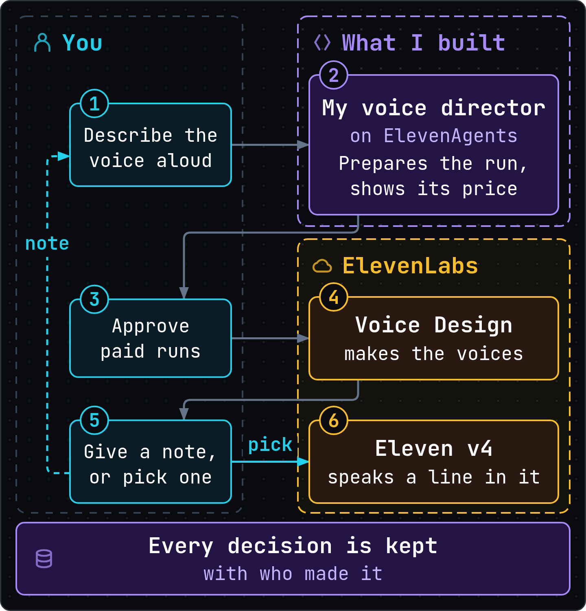
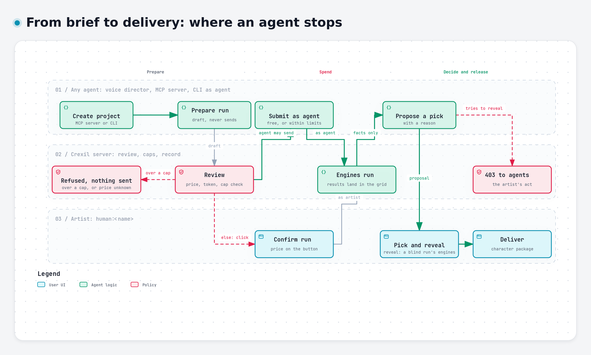

# How agents work in Crexil

In Crexil, agents prepare runs, start the ones their limits allow and propose picks with a
reason, while delivery, blind reveals, project spending limits and voice sessions stay with the
artist. Two ways in are made for agents: the voice director, an agent built on ElevenAgents that
the artist talks to in a column of the app, and the MCP server in `tools/agent-door/`, which
[docs/agents.md](../agents.md) calls the MCP door, for Claude Code or any MCP client; any other
program can use the CLI or the HTTP API. The interactive diagrams at
[crexil.thakay.dev/agents](https://crexil.thakay.dev/agents/) link every box to the code and docs
it was drawn from.



## The short answer

- **One writer, many clients.** The Crexil server owns the store and the record. The app, the
  voice director, the MCP server and the CLI call the same HTTP actions, and every write names its
  author as the client states it, `human:<name>` or `agent:<name>` (law 19, the server is the
  only writer; law 23, every decision has an author).
- **Where agents stop.** Delivery, reveals, changes to a project's or a sequence's limits, voice
  sessions and resuming held paid work are the artist's: the server refuses them to agents with
  `403`.
- **A pick is recorded under whoever makes it** (law 23). Neither way in offers an agent a pick:
  the voice director's Pick button is the artist's click, and the MCP server has no pick tool.
  An agent that picks over the HTTP API is recorded under its own name.
- **Money moves within limits a person sets.** Every run states a spending limit, and the artist
  can set one for the project. A known price over either is refused before any engine is called,
  and an unknown price counts as over (law 22, money never moves without a cap). Agents send paid
  work only where the artist set a project limit.
- **Agents get facts, never media.** Neither way in hands an agent a take (the app's word for one
  output: an image, a mesh or a sound); answers carry facts, labels and reasons. That is a design
  choice: ElevenLabs' [Prohibited Use Policy](https://elevenlabs.io/use-policy) bars its output as
  input to machine learning, and every agent runs on a language model. It binds the two ways in,
  not the machine: the media routes serve any local program.

## The diagrams

Open them at [crexil.thakay.dev/agents](https://crexil.thakay.dev/agents/); each one's source is
the JSON of the same name in [diagrams/](diagrams/). The set opens on `authority-gates`, shown
below as a picture; online, every box links to the lines it was drawn from.

<picture>
  <source media="(prefers-color-scheme: dark)" srcset="brief-to-delivery-dark.png">
  
</picture>

| Diagram | Type | What it shows |
|---|---|---|
| `authority-gates` | Workflow | A run from brief to delivery, in lanes: where every agent stops, what the server refuses, and where the artist takes over |
| `agent-surfaces` | Architecture | Every way in, the server and the store, the ElevenLabs services and OpenRouter, and the name each writes as |
| `voice-director-1-ask` | Sequence | A voice session starting, and a run asked for by voice: the engines it lists first, when the run starts at once, when it waits for a click |
| `voice-director-2-pick` | Sequence | Playback with the microphone muted, a proposal, the artist's pick, the session's end |

The two pictures are Archify's own PNG export of `authority-gates` (Export, PNG), one in each
theme, at half its size.

## Who can do what

`yes`: offered by the way in and accepted by the server. `no`: the way in has no such action.
`403`: refused to agents by the server. Full table:
[docs/agents.md](../agents.md#what-an-agent-may-and-may-not-do).

| Action | The artist, in the app | The voice director | The MCP server | CLI or HTTP, as an agent |
|---|---|---|---|---|
| List engines, with price and readiness | yes | yes: audio, or image on request | yes | yes |
| Read a project, a run, the record | yes | the open project's brief, limit and 3 latest runs; a run's status | yes, and search the record | yes |
| Create a project; prepare an image or 3D run | yes | no | yes | yes |
| Prepare an audio run | yes | yes: 1 to 4 engines, 1 to 4 attempts each | yes | yes |
| Start a free run on this machine | yes | yes, at once | yes | yes |
| Start a free run that leaves the machine | yes | no: a card waits for a click | yes | yes |
| Start a paid run | yes, price on the button | no: a card, price on its button | up to its own per-run limit (`--max-run-usd`), restating the reviewed amount, where the artist set a project limit | within the limits, where the artist set a project limit |
| Play a take for a person | yes | yes | no | no |
| Propose a pick, with a reason | the artist picks | yes | yes | yes |
| Pick | yes | no: Pick on its card is the artist's click | no | accepted, under the agent's name |
| Pause, cancel or resume work | yes | no | no | pause and cancel; resume free work only, else `403` |
| Create a sequence | yes | no | no | at the default limits only (16 attempts, $0) |
| Reveal a blind run, deliver, change a project's or a sequence's limits, start or end a voice session | yes | no | no | `403` (reviewing a delivery is allowed) |

## ElevenLabs in Crexil

| Piece | Role in Crexil | Called by | Charged by |
|---|---|---|---|
| ElevenAgents | Runs the voice director's conversation: listens, reasons, speaks, and asks the panel to run its tools | The browser, with a short-lived token the server gets with the key | Call minutes, plus the model |
| Voice Design (row `elevenlabs-voice-design`) | Engine for `voice-design` (also served by the local Qwen3-TTS): three previews from a description | The server, through ElevenAPI | The preview line's characters |
| Eleven v4 (row `elevenlabs-v4`) | Engine for `speak`: a line in a chosen voice | The server, through ElevenAPI | The line's characters |
| Sound Effects (row `elevenlabs-sfx`) | Engine for `sfx` | The server, through ElevenAPI | Seconds of sound requested |
| Account reads | Subscription and voices, for readiness; speech history, to recover a lost take without paying again | The server, through ElevenAPI | No run charge |

The voice director is Crexil's agent, configured in `tools/voice-director/`; ElevenAgents is the
platform that runs it. Its tools are client tools, not server tools or webhooks: ElevenAgents asks
the panel in the browser to run them, and the panel calls the local server, which answers
loopback addresses only.

ElevenLabs' pricing page lists ElevenAgents call minutes at $0.08 each beyond a plan's included
minutes, with the language model billed on top. That is the vendor's figure, not one Crexil
measures: `USD_PER_MINUTE` in `cockpit/server/app/agent_door.py` holds it and cites the page, and
the panel's meter shows it as an estimate.

## The ways in, in short

**The voice director** opens from `VOICE DIRECTOR ›` in the top bar as a column, and listens:
there is no text box. It writes as `agent:voice-director`, and what the artist confirms on its
cards goes under the artist's name. It reasons with Anthropic's Claude Haiku 4.5, chosen inside
ElevenAgents, and speaks with `eleven_v4_turbo`. More:
[tools/voice-director/README.md](../../tools/voice-director/README.md).

**The MCP server**, `tools/agent-door/crexil_mcp.py`, speaks MCP over stdio to its client and HTTP
to a local Crexil; it never opens the store. Its twelve tools act as `agent:<name>` (`Claude` by
default), and its per-run limit, `--max-run-usd`, is $0 unless the person launching it raises
it. More: [tools/agent-door/README.md](../../tools/agent-door/README.md).

**The CLI and the HTTP API.** `scripts/crexil.py` reaches every shared action under
`/api/crexil/`, plus import, backup, restore, the decision record and reveal, and every change
names its author with `--actor`. The contract is `cockpit/openapi.json`, explained in
[docs/agents.md](../agents.md). The agent rules bind clients that say they are agents; they are
not a sandbox ([SECURITY.md](../../SECURITY.md#localhost-trust)).

**What leaves the machine.** In a voice session, the microphone audio and what the director reads
(the brief, run prompts, take labels, reasons) go to ElevenLabs and the language model. Crexil's
settings on its agent tell ElevenLabs to keep no audio and to delete the conversation after 7 days
(`record_voice: false` and `retention_days: 7` in `tools/voice-director/agent.json`). The
microphone mutes before any take plays. An MCP client receives the MCP server's answers, and a
hosted image run sends its prompt, any source images and its settings to OpenRouter. All
destinations: [SECURITY.md](../../SECURITY.md#what-leaves-your-machine).

## Workflows you can run today

| Workflow | Way in | Who clicks what | Cost |
|---|---|---|---|
| **Cast a voice by talking.** From the artist's words, the voice director prepares a Voice Design run, which waits on a card with its price; it plays the results and proposes one from what the artist says | The voice director | The artist: Start, Run, Pick | Session minutes, plus the preview line's characters |
| **Draft voices from Claude Code.** The [worked example](../agents.md#worked-example-casting-a-voice): a `voice-design` run on the local engine, submitted at $0, and a proposal with a reason. Paid runs need a raised per-run limit and a project limit | The MCP server | The artist: sets limits, picks, delivers | Free at $0; paid runs up to the per-run limit |
| **Compare blind.** One blind image run across several models, hosted and local; their names stay hidden from agents too until the artist reveals them | The MCP server or the CLI | The artist: picks, then reveals | As each engine charges |
| **Speak a character's lines.** One `speak` run per line, from the picked voice | Either way in | The artist: picks each line | Per line, as the engine charges |
| **Image to 3D.** Images on local engines, then a `mesh` run from a chosen image | The MCP server or the CLI | The artist: picks, delivers | Free on local engines |
| **Feed a pipeline.** A tool writing as `agent:Pipeline` prepares runs and exports `decisions.jsonl` and `deliveries.csv` for an asset tracker | The CLI | The artist: delivers | As reviewed |

## Limits

- **The voice director** makes only audio runs and cannot create projects, pause, cancel, reveal
  or deliver; it sees the open project's 3 latest runs. It never hears a take: it works from the
  artist's words and from facts such as length and state. It starts nothing paid or off the
  machine; under Docker, local runtimes at `host.docker.internal` count as off it.
- **The voice director is off** until the installation has an ElevenLabs key, applies the agent
  to its account, sets `ELEVENLABS_VOICE_AGENT_ID` and gives it minutes
  (`CREXIL_VOICE_MINUTES_CAP`, 0 by default). By default a session ends at 5 minutes, and Crexil
  sets the agent, on ElevenLabs' side, to 10 conversations a day, one at a time.
- **The MCP server** has no tool to pick, reveal, deliver, change limits, start a voice session,
  pause, cancel, run a sequence or import. Its per-run limit compares money, not location: a
  hosted model priced at $0 passes a $0 limit and sends its prompt off the machine.
- **Agents do not judge quality.** No agent sees or hears a take through either way in; a person
  does.
- **A pick's reason is optional** at the server. **A project has no spending limit** until the
  artist sets one, and until then agents send only free work in it.
- **Caps are on published prices**; providers bill what they measure, so set limits on their side
  too.
- **The legacy canvas** (`#/w`) has no per-run cap and records no author. No agent way in uses it.

## Terms

| Term | Meaning |
|---|---|
| Take label | The grid's name for a take: run number, cell letters, `.n` for an attempt's later ones (`3B`, `3B.2`) |
| Run, attempt | A run (`direction` in code; one send of it is a `turn`) asks one or more engines for one thing; an attempt is one call to one engine, and can return several takes |
| Review | A read with no side effects: can the run go, what it reserves, and a token binding exactly what will run |
| Proposal, pick | A proposal (an assessment) is an agent's recommendation with a reason, recorded as its own decision. A pick (the selection) is the choice, recorded under whoever made it |
| Blind run | A run that hides which engine made each take, from everyone, until the artist reveals it |
| Sequence | Runs in steps under their own limits; each step takes every good result, or the chosen ones, of the steps it depends on |

## Where things live

| What | Where |
|---|---|
| Agent contract, permissions, worked example | [docs/agents.md](../agents.md) |
| Agent rules, keys, what leaves the machine | [SECURITY.md](../../SECURITY.md) |
| The 23 laws | [docs/PRD.md](../PRD.md#3-the-laws), section 3 |
| The MCP server and its tests | `tools/agent-door/` |
| The voice director's configuration | `tools/voice-director/` |
| The voice director's panel and tools | `cockpit/web/src/app/voice-director/` |
| Run view for agents, voice sessions | `cockpit/server/app/agent_door.py` |
| Refusals to agents | `api_crexil.py`, `execution_controls.py`, `crexil_execution.py`, `agent_door.py` in `cockpit/server/app/` |
| Engines and prices | `configs/engines.json`; hosted image engines from OpenRouter's live catalogue, some pinned in `providers.json` |

## How to redraw the diagrams

The diagrams are drawn with [Archify](https://github.com/tt-a1i/archify), and the viewer at
[crexil.thakay.dev/agents](https://crexil.thakay.dev/agents/) is built with
[archify-index](https://github.com/Thakay/archify-index). Each JSON pins this repository and the
commit its source lines were read at (`meta.repository`), and Archify checks every box's lines
against that commit; it needs the clone's `origin` to be this repository. To redraw one, from the
root of a clone, with `<type>` the JSON's `diagram_type` and `<archify>` an Archify checkout:

```sh
node <archify>/bin/archify.mjs finalize <type> docs/agentic-map/diagrams/<name>.json /tmp/agent-map/<name>.html --repo-root . --quality showcase
```

After a change to code that a box cites, update its lines and the pinned commit, then redraw.
